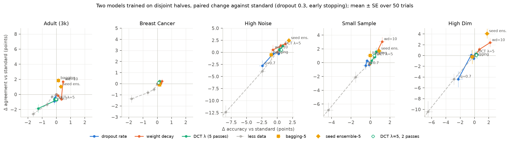
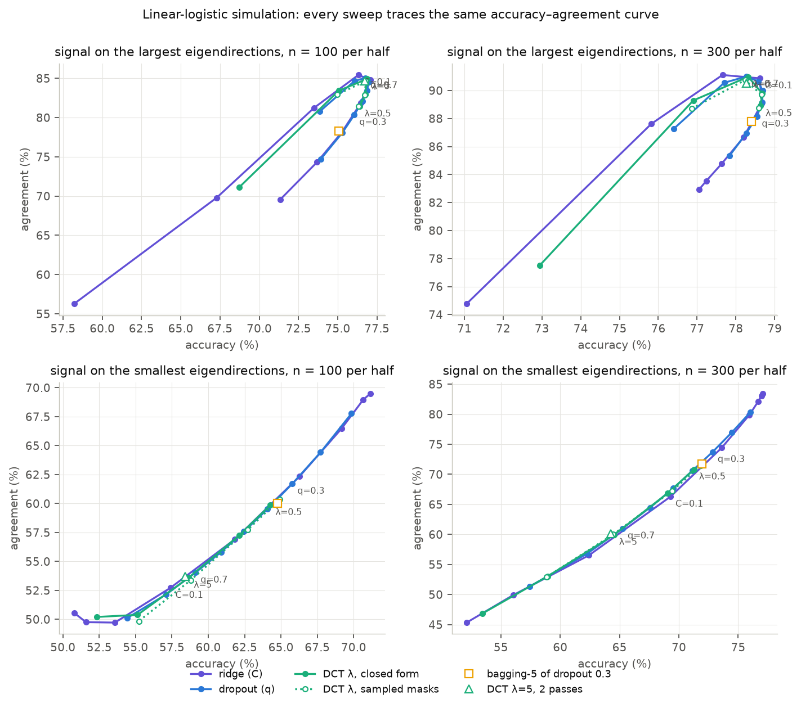
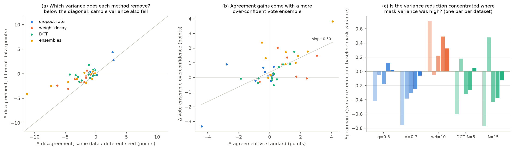

## Dropout-Consistency Training and the stability ladder

Turney (1995) argued that a good learner should produce essentially the same concept when trained on two independent samples from the same distribution. Stability here means **agreement**: train two models on disjoint samples and count how often they give the same label on new data. The machine-learning literature calls the opposite quantity **prediction churn**.

**Dropout-Consistency Training (DCT)** tries to build stability into one model. Each minibatch is run through the network n times, each time with a different random dropout mask, and the loss penalizes the n predictions for disagreeing:

```python
def dct_loss(model, x, y, n_passes=5, lam=1.5):
    logits = [model(x) for _ in range(n_passes)]                  # dropout on
    ce = mean(cross_entropy(z, y) for z in logits)
    penalty = mean(mse(softmax(z_i), softmax(z_j)) for i < j)
    return ce + lam * penalty
```

The loss is old (Bachman et al. 2014; fraternal dropout, Zolna et al. 2018; R-Drop, Liang et al. 2021). None of those papers measure cross-sample agreement, and the churn papers never test dropout consistency. So this repo asks the one open question: **is DCT a good way to buy cross-sample stability, and is it better than the one-line alternatives, raising the dropout rate or the weight decay, at equal accuracy?** It answers in three steps: a formalization that says what to expect, a linear simulation where the formalization is exact, and an MLP experiment on five small tabular datasets with a full regularization frontier.

**Bottom line.** No. DCT is a reweighted dropout penalty, and it behaves like one. In the linear simulation DCT with λ=5 lands on the same accuracy–agreement curve as plain dropout at rate q≈0.7, within 0.1 points. In the MLP experiment DCT raises agreement by at most 1.3 points, and a single-pass model with weight decay 10 beats it by 2 to 3 points at the same accuracy on three of five datasets (ties on the other two). What DCT does remove is *seed* variance (two seeds on the same data agree 2 to 3 points more), not the variance that comes from drawing a new sample. It costs five forward passes per step for that. If you want one model that agrees more with its own retrains, raise the weight decay; if you can afford five models, average five seeds.

### Choosing a churn reducer (small tabular MLPs)

Paired change against `standard` (dropout 0.3, early stopping), mean over 50 trials and five datasets, in points. Full per-dataset numbers are in Table 1; the frontier comparison in Table 2.

| Method | Train / predict cost | Δ accuracy | Δ agreement | vs single-pass frontier at equal accuracy |
|---|---|---|---|---|
| `wd=10` (weight decay) | 1× / 1× | +0.7 | **+1.6** | defines it |
| `dropout=0.5` | 1× / 1× | −0.3 | +0.0 | part of the sweep; below `wd=10` everywhere |
| `DCT lam=5` | 5× / 1× | +0.3 | +0.4 | −0.1 to −2.9 |
| `seed-ens-5` | 5× / 5× | **+1.0** | **+1.9** | +1.7 to −1.4 |
| `bagging-5` | 5× / 5× | −0.2 | +0.4 | −0.1 to −2.6 |

- **One model, no extra compute: weight decay.** It raises both accuracy and agreement on every dataset but High Noise, and every other single-model method sits below it at matched accuracy.
- **Five models at prediction time: average five seeds.** It is the only arm that beats the frontier anywhere (High Dim, +1.7 ± 0.7), and it reduces both seed and sample disagreement. Bagging on these sample sizes does little; Breiman (1996) predicts that for a learner this stable.
- **DCT's niche is narrow:** one model at prediction time, and you specifically want two seeds on the same data to agree. Even there, `wd=10` does as much (Table 3).

### Why you'd expect this (the formalization)

Write S for a training sample, f_S(x) for the predicted probability of class 1, and ŷ_S(x) for the hard label.

1. **Disagreement is a variance.** Let π(x) be the share of training samples whose model says class 1 at x. Two independent models agree at x with probability π² + (1−π)², so disagreement is 2·E_x[π(x)(1−π(x))]: twice the variance of the hard vote across samples. Exact, with no model assumptions. The experiment measures π(x) directly from the ~30 models that see each test point.
2. **Hard agreement cannot be bought by flattening.** Any monotone rescaling of f−½ (a temperature, a uniform shrink toward ½) leaves every hard label unchanged, so it leaves agreement unchanged. It does move soft metrics like exp(−symmetric KL), which is why the earlier version of this study, which used that metric, saw large "stability" gains from under-confidence. `results/temperature.csv` shows hard agreement identical at T = 0.5, 1, 2 while the soft metric moves from 0.70 to 0.95.
3. **In a linear model, DCT is dropout's own penalty with a different weighting.** With input dropout at rate q and the usual 1/(1−q) rescaling, the logit's variance across masks is q/(1−q)·Σⱼ wⱼ²xⱼ². The pairwise MSE of n predictions equals twice their variance for every n ≥ 2 (so n changes only gradient noise), and by the delta method Var(p) ≈ [p(1−p)]²·Var(logit). So the DCT penalty is
   2λ·q/(1−q)·E_x[(p(1−p))²·Σⱼ wⱼ²xⱼ²],
   while dropout's own implicit regularizer (Wager, Wang & Liang 2013) is
   ½·q/(1−q)·E_x[p(1−p)·Σⱼ wⱼ²xⱼ²].
   Same object, two differences: DCT's weight is [p(1−p)]² instead of p(1−p), so it acts only near the decision boundary and switches off on confident points; and its coefficient is 4λ·p(1−p) times dropout's, which at λ=5 and typical p(1−p) of 0.1 to 0.25 is 2 to 5×. That predicts **DCT λ=5 at q=0.3 ≈ plain dropout at q between 0.55 and 0.7**, a pre-registered test. For deep nets, Wei, Kakade & Ma (2020) derive the analogous explicit dropout regularizer, q/(1−q)·Σ_h (a_h ∂f/∂a_h)², and show it reproduces most of dropout's effect.
4. **The penalty does not point at sample variance.** Across-sample variance of a prediction is gᵀΣ_S g, with g the gradient of f with respect to the weights and Σ_S the covariance of trained weights across samples. Mask variance is gᵀΣ_m g, where Σ_m is the covariance dropout induces on the weights: block-diagonal by unit, rank one per unit, proportional to the weights themselves, and independent of the data. DCT penalizes variance under Σ_m. It lowers Σ_S only indirectly, by shrinking whatever it penalizes. This is the formal version of the ACT repo's observation that dropout noise "carries no information about the data": an augmentation penalty uses directions along which the truth is known to be flat; Σ_m has no such property.
5. **Hypothesis: DCT reduces seed variance, not sample variance.** Mask-insensitivity makes the fit less sensitive to initialization and batch order. Turney's target is the sample component. Tested by training an extra seed on the same half.
6. **Agreement at fixed accuracy is bought with overconfidence.** Jiang, Nagarajan, Baek & Kolter (2022): if the vote ensemble over retrains is calibrated, expected disagreement equals expected test error. So a method that raises agreement without raising accuracy must make the vote ensemble more confident than its accuracy warrants.

The rungs of the ladder, by how directly each attacks sample variance: (1) more data; (2) shrinkage, which includes weight decay, the dropout rate, early stopping and DCT; (3) averaging seeds, which removes seed variance only; (4) bagging, which approximates the across-sample average inside one sample; (5) anchoring to a previous model by distillation (Jiang et al. 2022), a different target and out of scope. DCT is rung 2.

### Design

- **Linear simulation** (`linear_sim.py`). x ~ N(0, Σ) in 30 dimensions with eigenvalues 1/k; the true coefficient lies on the five largest eigendirections (shrinkage removes noise and keeps signal) or the five smallest (shrinkage eats the signal). Bayes accuracy 80%. Each of 50 trials draws two disjoint halves of n = 100 or 300 and a 2,000-point test set. Sweeps: ridge over C; dropout via Wager et al.'s closed-form penalty over q; DCT over λ at q = 0.3 in closed form and with sampled masks (5 passes, and 2 passes at λ=5); bagging-5. Deterministic arms are fit by L-BFGS, so the comparison is between penalties, not optimizers.
- **MLP experiment** (`experiment.py`). Five datasets: three synthetic `make_classification` problems (High Noise, Small Sample, High Dim), Breast Cancer, and 3,000 rows of UCI Adult. Per trial, 30% is held out as a test set and the rest is split into two disjoint halves; each half keeps a fifth for early stopping (patience 5 on validation cross-entropy, up to 100 epochs). Three models per arm: A on half 1, B on half 2 with the same seed, C on half 1 with another seed. (A, B) is the cross-sample pair; (A, C) the seed-only pair. The network is a 2-layer MLP (64 units, ReLU, dropout), AdamW, batch 32. 50 trials, every arm on the same splits.
- **Arms.** `standard` (dropout 0.3); dropout 0.1 / 0.5 / 0.7; weight decay 1 / 3 / 10 / 30; `5 passes` (DCT's compute, no penalty); DCT λ = 0.5 / 1.5 / 5 / 15 with 5 passes, and λ=5 with 2 passes; `bagging-5` and `seed-ens-5` (five models, probabilities averaged); and `standard` on 25 / 50 / 75% of each half, to price agreement in data. The pre-registered primary DCT arm is λ=5, 5 passes.
- **Metrics.** `agree`, the share of test points on which the pair gives the same label; Cohen's κ, which is agreement corrected for the pair's label frequencies, so collapsing to the majority class does not count (weight decay 30 does collapse on Adult); accuracy; confidence; the vote-ensemble statistics of point 6; and per-point across-model and mask variances for the mechanism test.
- **Frontier test.** For each target arm, the agreement of the single-pass sweeps (dropout rate and weight decay) is interpolated at the target's accuracy along their upper envelope. The SE is a bootstrap over trials, so it carries the pairing. Pre-registered rule: DCT "beats the frontier" if it is above by more than two SEs on at least three of five datasets.

### Results





<!-- tables:start -->
**Table 1. Paired change against `standard`, two models on disjoint halves.** Percentage points, mean ± paired SE over 50 trials; Δ accuracy / Δ agreement.

| Arm | Adult (3k) | Breast Cancer | High Noise | Small Sample | High Dim |
|---|---|---|---|---|---|
| `dropout=0.5` | +0.0 ± 0.1 / -0.1 ± 0.2 | +0.1 ± 0.0 / +0.2 ± 0.1 | -0.7 ± 0.3 / -0.3 ± 0.6 | -0.4 ± 0.2 / +0.3 ± 0.3 | -0.5 ± 0.4 / +0.1 ± 0.9 |
| `dropout=0.7` | -0.1 ± 0.1 / -0.9 ± 0.4 | +0.2 ± 0.1 / +0.2 ± 0.2 | -2.4 ± 0.5 / -2.8 ± 1.1 | -0.5 ± 0.3 / -0.4 ± 0.6 | -2.3 ± 0.6 / -4.4 ± 1.5 |
| `wd=3` | +0.3 ± 0.1 / -0.6 ± 0.2 | +0.3 ± 0.1 / +0.0 ± 0.1 | +1.3 ± 0.3 / +1.7 ± 0.6 | +0.4 ± 0.2 / +0.8 ± 0.4 | +0.7 ± 0.2 / +1.1 ± 0.5 |
| `wd=10` | +0.5 ± 0.1 / +1.7 ± 0.2 | +0.3 ± 0.1 / +0.2 ± 0.2 | -0.7 ± 0.4 / +0.5 ± 1.0 | +1.2 ± 0.3 / +3.0 ± 0.7 | +2.2 ± 0.4 / +2.4 ± 0.8 |
| `5 passes` | -0.2 ± 0.1 / -0.7 ± 0.4 | +0.0 ± 0.1 / +0.2 ± 0.1 | +0.3 ± 0.2 / +0.4 ± 0.4 | +0.0 ± 0.2 / -0.2 ± 0.4 | -0.1 ± 0.2 / -0.1 ± 0.6 |
| `DCT lam=1.5` | -0.1 ± 0.1 / -0.7 ± 0.4 | +0.1 ± 0.1 / +0.1 ± 0.1 | +0.3 ± 0.3 / +0.5 ± 0.5 | +0.1 ± 0.1 / +0.3 ± 0.4 | +0.1 ± 0.2 / +0.1 ± 0.5 |
| `DCT lam=5` | +0.0 ± 0.1 / -0.8 ± 0.4 | +0.1 ± 0.0 / +0.2 ± 0.1 | +0.9 ± 0.3 / +1.3 ± 0.5 | +0.4 ± 0.2 / +0.9 ± 0.4 | +0.3 ± 0.2 / +0.3 ± 0.6 |
| `DCT lam=15` | -1.3 ± 0.2 / -1.9 ± 0.6 | +0.2 ± 0.1 / +0.2 ± 0.1 | +0.5 ± 0.3 / +0.6 ± 0.7 | +0.6 ± 0.3 / +1.6 ± 0.6 | +0.4 ± 0.3 / +0.1 ± 0.8 |
| `DCT lam=5, 2 passes` | -0.0 ± 0.1 / -0.7 ± 0.3 | +0.1 ± 0.1 / +0.1 ± 0.1 | +0.7 ± 0.3 / +0.5 ± 0.6 | +0.4 ± 0.2 / +1.0 ± 0.4 | +0.3 ± 0.2 / +0.1 ± 0.6 |
| `bagging-5` | +0.2 ± 0.1 / +1.8 ± 0.3 | +0.2 ± 0.1 / -0.1 ± 0.2 | -0.9 ± 0.3 / -0.5 ± 0.8 | -0.0 ± 0.3 / +1.0 ± 0.7 | -0.3 ± 0.4 / -0.3 ± 1.3 |
| `seed-ens-5` | +0.3 ± 0.1 / +1.0 ± 0.2 | +0.1 ± 0.1 / +0.1 ± 0.1 | +1.9 ± 0.2 / +2.4 ± 0.6 | +0.9 ± 0.2 / +1.7 ± 0.6 | +1.8 ± 0.4 / +4.1 ± 0.9 |
| `data=50%` | -0.7 ± 0.1 / -1.4 ± 0.4 | -0.7 ± 0.1 / -0.8 ± 0.2 | -8.4 ± 0.6 / -12.4 ± 1.4 | -4.3 ± 0.5 / -6.9 ± 1.1 | -6.5 ± 0.6 / -10.4 ± 2.0 |

**Table 2. Agreement relative to the single-pass frontier at the same accuracy.** The frontier is the best of the dropout-rate and weight-decay sweeps at each accuracy (upper envelope, linearly interpolated). Points, mean ± bootstrap SE over trials; negative means the frontier does better.

| Arm | Adult (3k) | Breast Cancer | High Noise | Small Sample | High Dim |
|---|---|---|---|---|---|
| `DCT lam=1.5` | -3.0 ± 0.5 | -0.2 ± 0.2 | -1.3 ± 0.5 | -2.8 ± 0.5 | -2.2 ± 0.7 |
| `DCT lam=5` | -2.9 ± 0.5 | -0.1 ± 0.2 | -0.4 ± 0.5 | -2.2 ± 0.5 | -2.1 ± 0.7 |
| `DCT lam=15` | -5.2 ± 0.6 | -0.0 ± 0.2 | -1.1 ± 0.6 | -1.5 ± 0.4 | -2.2 ± 0.7 |
| `DCT lam=5, 2 passes` | -2.8 ± 0.4 | -0.2 ± 0.2 | -1.2 ± 0.6 | -2.0 ± 0.5 | -2.3 ± 0.7 |
| `bagging-5` | -0.1 ± 0.4 | -0.4 ± 0.2 | -2.2 ± 0.7 | -2.0 ± 0.6 | -2.6 ± 1.2 |
| `seed-ens-5` | -0.8 ± 0.3 | -0.2 ± 0.2 | more accurate than any frontier point | -1.4 ± 0.4 | +1.7 ± 0.7 |

**Table 3. Where the disagreement goes.** Change vs `standard` in disagreement between two seeds on the same half (seed) and between the two halves (sample), in points. `standard` row: levels.

| Arm | Adult (3k) | Breast Cancer | High Noise | Small Sample | High Dim |
|---|---|---|---|---|---|
| `standard` (levels) | 5.2 seed, 7.8 sample | 1.2 seed, 3.1 sample | 13.5 seed, 25.9 sample | 7.8 seed, 15.2 sample | 20.2 seed, 35.0 sample |
| `dropout=0.5` | -0.1 seed, +0.1 sample | -0.0 seed, -0.2 sample | -1.1 seed, +0.3 sample | -0.5 seed, -0.3 sample | -0.5 seed, -0.1 sample |
| `wd=10` | -1.9 seed, -1.7 sample | -0.8 seed, -0.2 sample | -1.6 seed, -0.5 sample | -4.5 seed, -3.0 sample | -6.3 seed, -2.4 sample |
| `DCT lam=5` | -0.4 seed, +0.8 sample | -0.0 seed, -0.2 sample | -2.4 seed, -1.3 sample | -0.9 seed, -0.9 sample | -3.3 seed, -0.3 sample |
| `DCT lam=15` | -1.2 seed, +1.9 sample | -0.1 seed, -0.2 sample | -2.9 seed, -0.6 sample | -2.7 seed, -1.6 sample | -4.3 seed, -0.1 sample |
| `seed-ens-5` | -3.1 seed, -1.0 sample | -0.7 seed, -0.1 sample | -7.3 seed, -2.4 sample | -4.5 seed, -1.7 sample | -11.3 seed, -4.1 sample |
| `bagging-5` | -1.6 seed, -1.8 sample | -0.2 seed, +0.1 sample | -0.6 seed, +0.5 sample | -0.6 seed, -1.0 sample | -1.9 seed, +0.3 sample |

**Table 4. The vote ensemble.** Over the ~30 models that saw each test point: pairwise disagreement, mean error, and overconfidence (mean vote share of the majority class minus majority-vote accuracy). Under a calibrated vote ensemble disagreement would equal error (Jiang et al. 2022).

| Arm | Adult (3k) | Breast Cancer | High Noise | Small Sample | High Dim |
|---|---|---|---|---|---|
| `standard` | 7.2 / 16.5 / +10.6 | 2.9 / 3.4 / +0.5 | 22.5 / 28.6 / +8.2 | 14.0 / 18.5 / +5.8 | 31.8 / 34.5 / +5.4 |
| `wd=10` | 5.6 / 16.0 / +11.6 | 2.3 / 3.0 / +0.8 | 22.1 / 29.3 / +10.2 | 10.7 / 17.3 / +7.3 | 28.9 / 32.2 / +5.3 |
| `DCT lam=5` | 7.8 / 16.5 / +10.3 | 2.7 / 3.2 / +0.8 | 21.7 / 27.7 / +9.1 | 13.0 / 18.0 / +6.7 | 31.0 / 34.2 / +5.6 |
| `seed-ens-5` | 6.0 / 16.2 / +11.5 | 2.7 / 3.2 / +0.7 | 19.4 / 26.7 / +10.0 | 12.1 / 17.6 / +6.8 | 27.3 / 32.7 / +9.2 |

**Table 5. Linear simulation: DCT λ=5 against the sweeps.** Δ agreement at matched accuracy (points ± SE), and the dropout rate whose agreement equals DCT λ=5's, with the accuracy gap between them.

| Scenario, n | vs dropout sweep | vs ridge sweep | equivalent q | accuracy gap |
|---|---|---|---|---|
| bottom, 100 | -14.2 ± 1.6 | -15.9 ± 1.8 | 0.72 | -0.0 |
| bottom, 300 | -20.4 ± 1.1 | -23.5 ± 1.1 | 0.73 | +0.0 |
| top, 100 | +0.1 ± 0.2 | -0.1 ± 0.2 | 0.73 | +0.3 |
| top, 300 | +0.0 ± 0.1 | +0.0 ± 0.1 | 0.69 | +0.0 |
<!-- tables:end -->

### What the tests say

- **Point 3, the mapping: confirmed.** In the linear simulation DCT λ=5 reproduces plain dropout at q = 0.69 to 0.73 with an accuracy gap of 0.0 to 0.3 points (Table 5); the forecast was 0.55 to 0.7. The closed-form penalty and the sampled-mask loss agree within 0.3 points everywhere, so the delta-method form is the right description, and 2 passes match 5 passes, so the extra passes buy nothing but a quieter gradient. Every sweep traces the same curve (figure above): when the signal is on the large eigendirections shrinkage helps all of them equally, and when it is on the small ones shrinkage hurts all of them equally. Bagging a linear model changes nothing, as Breiman (1996) says it should.
- **The frontier: DCT is dominated.** In the MLP experiment DCT λ=5 sits 2.1 to 2.9 points *below* the single-pass frontier on Adult, Small Sample and High Dim (|t| > 3), 0.4 ± 0.5 below on High Noise, and at the ceiling on Breast Cancer (Table 2). The frontier is weight decay 10. Against the dropout sweep alone DCT is a tie or slightly more accurate, which is the earlier finding; the earlier study never tried a weight decay that was large enough to matter with AdamW (the penalty is multiplied by the learning rate, so 0.1 does nothing).
- **Point 5, seed vs sample: confirmed.** DCT λ=5 cuts seed-only disagreement by 2.4 to 3.3 points on the three noisy datasets but cross-sample disagreement by only 0.3 to 1.3, and on Adult cross-sample disagreement *rises* by 0.8 while seed disagreement falls (Table 3; mechanism figure, panel a). Weight decay 10 cuts both, by similar amounts. DCT is a seed-variance reducer.
- **Point 6, overconfidence: holds in direction, not as an identity.** The vote ensemble here is far from calibrated: on Adult, two models disagree on 7% of points but each is wrong on 17%, so the thirty models mostly share their mistakes (bias, not variance). Across arms, each point of agreement gained comes with about half a point of added vote overconfidence (panel b, slope 0.5). The clean "disagreement equals error" identity needs a regime with more variance than bias than these small problems have.
- **Point 4, targeting: the penalty acts where the vote is uncertain, and nowhere else.** At baseline, mask variance predicts across-sample variance well (Spearman 0.54 to 0.94 on the logit scale), so Σ_m is not useless as a map of where the fit varies. But DCT's variance reduction is *negatively* correlated with baseline mask variance on four of five datasets (−0.2 to −0.8; panel c), while weight decay's is positively correlated (0.5 to 0.9). That is the [p(1−p)]² weighting from point 3: DCT switches off on confident points, which are exactly where mask variance is largest, and if anything pushes their logits further out. Weight decay shrinks everywhere, including there.
- **Price in data.** Agreement rises by 1.3 (Adult) to 10 (High Noise) points per doubling of the training data. Weight decay 10 is worth 2.3× the data on Adult and 1.1 to 1.5× elsewhere; DCT λ=5 is worth 1.1× on High Noise and less than 1× on Adult (`results/data_equivalents.csv`).
- **Protocol.** With a fixed budget of 30 epochs and no validation split (the original protocol) DCT and dropout 0.5 both gained 1 to 2 points on the earlier run. Early stopping is itself a rung-2 regularizer, and once it is in place the other shrinkage methods have less to add; Table 6 reports the fixed-epoch run for comparison.



### Novelty

- **The method is pseudo-ensemble regularization** (Bachman, Alsharif & Precup 2014), later fraternal dropout (Zolna et al. 2018) and R-Drop (Liang et al. 2021). Wei, Kakade & Ma (2020) show the explicit mask-variance penalty reproduces most of what dropout does. None measure agreement between models trained on different samples.
- **The evaluation is Turney's (1995).** Madani, Pennock & Flake (2004) used disjoint-halves agreement as a validation tool. The churn literature (Milani Fard et al. 2016; Bhojanapalli et al. 2021; Jiang et al. 2022) measures agreement across seeds on the same data and reduces it with entropy regularization, co-distillation, ensembles and distillation; it does not test dropout consistency.
- **What this study adds** is small: a closed form for what DCT penalizes, a tested mapping from λ to an equivalent dropout rate, and the seed/sample decomposition showing which variance it removes.

### What was wrong before

- The first version used exp(−symmetric KL) as the stability metric and reported gains that came from under-confidence (point 2).
- The second version measured hard agreement but compared DCT with three regularizer settings, none of them a weight decay large enough to act, and called the result "on the frontier". With the frontier filled in, DCT is below it.
- Both trained for a fixed 30 epochs, which confounds the regularizer with how far training got.
- Neither separated seed variance from sample variance, which turns out to be the whole story.

### Reproduce

```
uv sync
make linear       # results/linear.csv, about 15 min on 6 cores
make experiment   # results/<dataset>.csv and results/preds/, about 40 min
make figures      # analysis tables, figures, and the README tables
make ci           # black, isort, flake8, pytest
```

`python experiment.py --fixed-epochs 30 --out results/fixed30` runs the original fixed-budget protocol.

### References

- Bachman, P., Alsharif, O. & Precup, D. (2014). [Learning with pseudo-ensembles](https://arxiv.org/abs/1412.4864). *NeurIPS*.
- Bhojanapalli, S. et al. (2021). [On the reproducibility of neural network predictions](https://arxiv.org/abs/2102.03349).
- Breiman, L. (1996). Bagging predictors. *Machine Learning* 24: 123–140.
- Jiang, H., Narasimhan, H., Bahri, D., Cotter, A. & Rostamizadeh, A. (2022). [Churn reduction via distillation](https://arxiv.org/abs/2106.02654). *ICLR*.
- Jiang, Y., Nagarajan, V., Baek, C. & Kolter, J. Z. (2022). [Assessing generalization of SGD via disagreement](https://arxiv.org/abs/2106.13799). *ICLR*.
- Liang, X., Wu, L. et al. (2021). [R-Drop: regularized dropout for neural networks](https://arxiv.org/abs/2106.14448). *NeurIPS*.
- Madani, O., Pennock, D. & Flake, G. (2004). Co-validation: using model disagreement to validate classification algorithms. *NeurIPS*.
- Milani Fard, M. et al. (2016). Launch and iterate: reducing prediction churn. *NeurIPS*.
- Turney, P. (1995). Bias and the quantification of stability. *Machine Learning* 20: 23–33.
- Wager, S., Wang, S. & Liang, P. (2013). Dropout training as adaptive regularization. *NeurIPS*.
- Wei, C., Kakade, S. & Ma, T. (2020). [The implicit and explicit regularization effects of dropout](https://arxiv.org/abs/2002.12915). *ICML*.
- Zolna, K., Arpit, D., Suhubdy, D. & Bengio, Y. (2018). [Fraternal dropout](https://arxiv.org/abs/1711.00066). *ICLR*.
